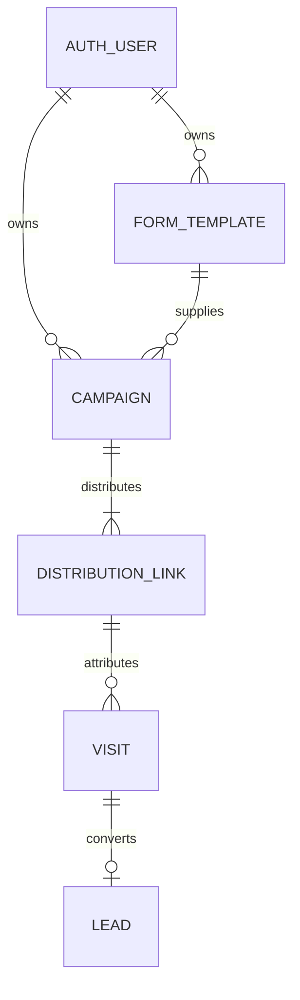

# Relational schema

Django auth_user and django_session provide operators and server-side sessions.
All application tables are created by crm/migrations/0001_initial.py.

FormTemplate: owner FK, name, sanitized HTML text, JSON field specification, created_at.
Campaign: owner FK, protected template FK, name, active, created_at.
DistributionLink: campaign FK, channel enum, unique UUID token; campaign/channel unique.
Visit: UUID primary key, protected link FK, indexed visitor UUID, indexed created_at.
Lead: unique protected visit FK, JSON data (JSONB in PostgreSQL), indexed created_at.

Visitor identities live in Visit rows and signed browser cookies; no separate
visitor profile table is necessary for distinct browser counts. All FK relationships
and uniqueness constraints are enforced by the relational database. Protected
relationships preserve attribution. Form HTML is never returned by administrative
JSON endpoints; submitted strings are escaped by Django when shown in the UI.
